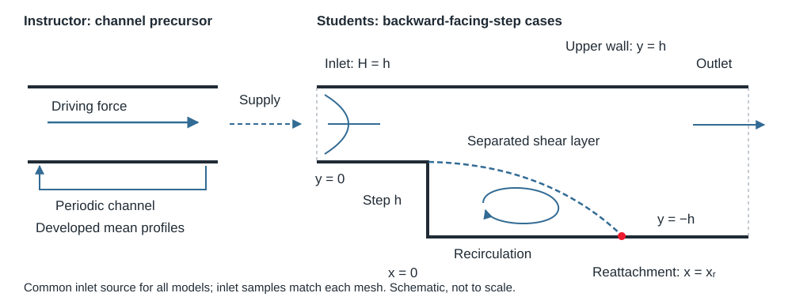

::: {.callout-note}
## What you will do

This guide supports Question 3 of the assignment PDF. Compare three configurations using developed channel inlets: standard $k$–$\varepsilon$ with wall functions, wall-resolved SST, and SST with wall functions. Prepared inlet data are included; you do not need to run a precursor. No grid-convergence study is required. The PDF defines the assessed deliverables. Use at most **four CPU cores in total** for this exercise, including concurrent jobs.
:::

## Why study the backward-facing step?

At the step edge, the flow separates and forms a recirculation region before reattaching to the downstream wall. This simple geometry provides a demanding test of turbulence models: turbulent momentum transport affects the growth of the separated shear layer, the reattachment location and the recovery downstream. Comparing the three configurations with DNS helps us assess model and wall-treatment effects, and distinguish numerical convergence from physical accuracy.

{#fig-q3-setup width=100%}

## Why supply a precursor profile?

The flow should reach the step with developed turbulent channel profiles. A **precursor** is a separate periodic channel calculation: flow leaving one end re-enters at the other, while a driving force balances wall friction and maintains the prescribed bulk velocity. It supplies the mean velocity and turbulence quantities at the step-case inlet. A uniform inlet would instead create a developing flow upstream and could change the separation and reattachment predictions.

For this assignment, the instructor has run one wall-resolved SST precursor and supplied its profiles for all three cases, sampled on each inlet mesh. These are steady RANS mean and turbulence-model fields, not instantaneous turbulent fluctuations. **You do not run, sample or map a precursor.** Start with the supplied step cases; their inlet data are already installed.

::: {.callout-tip}
## Before running: parallel processing and Slurm

- [OpenFOAM: running in parallel](../openfoam/parallel.qmd) explains decomposition, the parallel solver and reconstruction.
- [Slurm: requesting compute resources and monitoring jobs](../cluster/slurm.qmd) explains the scheduler and job management.

For this assignment, follow the [manual run commands below](#run-each-case-manually) inside an allocated compute session. No case-running bash helper script is required. The general guides also show batch scripts and eight-core examples; this assignment uses **at most four cores in total**, including concurrent runs. Match the allocated task count, `numberOfSubdomains` and MPI process count, and do not run the solver on the login node.
:::

## Start with the supplied cases

The OpenFOAM templates are available on the cluster at:

```text
/project/60004/02_Assignment3/01_OF_template
```

**Copy the templates into your own working folder before editing or running them.** Work on your personal copy, not in the shared project directory. For example, from your chosen personal working directory, create a new assignment folder:

```bash
mkdir Assignment3_OpenFOAM
cp -R /project/60004/02_Assignment3/01_OF_template/. Assignment3_OpenFOAM/
cd Assignment3_OpenFOAM
ls
```

Use a fresh folder name if `Assignment3_OpenFOAM` already exists, so old simulation outputs are not mixed with the templates. The commands below assume you are in the folder containing the three case directories. If the shared template contains an additional `OpenFOAM_Q3_Student` folder, enter that folder first.

Use the course ESI OpenFOAM environment:

```bash
module load openfoam/v2412
foamVersion
```

Your copied template provides three incomplete step cases, including revised meshes, numerical settings, prepared inlet data and reference profiles:

```text
OpenFOAM_Q3_Student/
    01_kEpsilon_wallFunctions/step/
    02_SST_wallResolved/step/
    03_SST_wallFunctions/step/
    DNS_data/
    postprocess_starter.py
```

Complete `SET_MODEL` in each `constant/turbulenceProperties`, the `SET_WALL_CONDITION` entries in the active turbulence fields, and the diagnostic includes marked TODO in `system/controlDict`. Inspect the field names and dimensions. The meshes and numerical settings are supplied; do not redesign them or change the inlet data. The completed configurations have been exercised by the instructor in v2412; the student cases deliberately require these setup choices.

The geometry has inlet height $H=h=0.1\,\mathrm m$, downstream height $2h$, and $\nu=1.48\times10^{-5}\,\mathrm{m^2/s}$. Calculate $U_b$ from $Re_H=U_bH/\nu=13800$. The step is at $x=0$, the upstream bottom wall at $y=0$, and the downstream bottom wall at $y=-h$.

Keep separate directories for each run. Start copies from the supplied inputs, rather than copying a completed case with old meshes and solution times. A useful run table is:

| Configuration | Near-wall mesh | Inlet source | Cells | $x_r/h$ |
|---|---|---|---|---|
| $k$–$\varepsilon$, wall functions | log-layer placement in attached flow | common supplied profile | | |
| SST, wall resolved | first-cell $y^+\lesssim1$ | common supplied profile | | |
| SST, wall functions | same supplied mesh as wall-function $k$–$\varepsilon$ | common supplied profile | | |

## Prepare the wall treatment before running

The student cases leave `k`, `nut` and `epsilon`/`omega` wall conditions as explicit placeholders. Complete them consistently with each requested wall treatment.

For the two wall-function configurations, use a consistent wall-function approach and document its limitations in separated flow. The following wall entries are a starting configuration:

| Field | Standard $k$–$\varepsilon$ | SST with wall functions |
|---|---|---|
| `U` | `noSlip` | `noSlip` |
| `k` | `kqRWallFunction` | `kqRWallFunction` |
| `nut` | `nutkWallFunction` | `nutkWallFunction` |
| `epsilon` | `epsilonWallFunction` | not transported |
| `omega` | not transported | `omegaWallFunction` |

For example, the wall-patch regex entry in `0/nut` becomes:

```foam
"(upstreamWall|stepWall|downstreamWall|upperWall)"
{
    type    nutkWallFunction;
    value   uniform 0;
}
```

Use `value $internalField;` for the initialization value of the corresponding `k`, `epsilon` or `omega` wall-function entries. Keep front/back patches `empty` and the mesh one cell thick in that direction. Apply the changes to your step cases only. The supplied template uses `0/` directly; it has no reset script to restore these edits.

Check actual $y^+$ after solving. In attached regions a log-layer wall-function mesh should generally place the first cell outside the buffer layer; $y^+\gtrsim30$ is a practical starting check, not a universal validity guarantee. Near separation and reattachment, a small reported wall-distance measure alone does not prove that the boundary layer is resolved. Report distributions and first-cell distances, not only a domain average.

The definition used by the diagnostic matters. With its default `useWallFunction true`, OpenFOAM's `yPlus` uses the selected `nut` wall function's expression where available. For `nutkWallFunction`, this is $y^*=C_\mu^{1/4}\sqrt{k_P}\,y_P/\nu$, which need not equal the shear-based $y^+=\sqrt{|\tau_w|/\rho}\,y_P/\nu$ away from equilibrium. For the resolved case's fixed-zero wall `nut`, the diagnostic computes the flow-based value. Retain the supplied diagnostic settings and identify this distinction in your interpretation; a vanishing wall shear need not make the wall-function diagnostic vanish. See the [OpenFOAM yPlus options](https://api.openfoam.com/2306/classFoam_1_1functionObjects_1_1yPlus.html).

The `02_SST_wallResolved/step` configuration resolves the near-wall SST solution. Its supplied mesh targets first-cell $y^+\lesssim1$ and enough smoothly graded cells through the boundary layer. Use `fixedValue` with `value uniform 0;` for wall `k` and `nut`, together with `omegaWallFunction` for wall omega and `noSlip` for velocity. At this resolution the omega boundary treatment supplies its viscous near-wall behavior; the presence of “WallFunction” in that boundary-condition name does not make this a high-Re log-law calculation. Check the actual wall distance and solved $y^+$.

Use the inlet dataset already included in each case. All datasets come from one common continuous profile, sampled at the corresponding inlet face centres. Compare the SST cases as complete wall-treatment-and-mesh configurations, not as a pure boundary-condition switch on identical meshes.
See the official [wall-function overview](https://www.openfoam.com/documentation/user-guide/5-models-and-physical-properties/5.3-turbulence-models), [kqRWallFunction](https://doc.openfoam.com/2306/tools/processing/boundary-conditions/rtm/derived/wall/kqRWallFunction/) and [nutkWallFunction](https://doc.openfoam.com/2312/tools/processing/boundary-conditions/rtm/derived/wall/nutkWallFunction/) documentation. Inspect the corresponding installed v2412 examples when editing the dictionaries.

## Use the supplied inlet profiles

Each step case already contains its matching inlet data in this structure:

```text
constant/boundaryData/inlet/
    points
    0/
        U
        k
        epsilon        # omega instead for SST
```

Do not exchange inlet folders between meshes. The underlying profile is common, but sample points differ between the wall-function and resolved meshes. A small velocity normalization preserves the same discrete bulk speed; `mapping.json` records it. The common precursor supplies $k$ and $\omega$; the $k$–$\varepsilon$ inlet uses $\varepsilon=0.09k\omega$. This does not force identical modeled eddy viscosity. `timeVaryingMappedFixedValue` reads the prepared steady profiles; nearest mapping selects the exact matching face-centre samples. Keep `nut` as `calculated` at the inlet.

Calculate the target bulk speed from $U_b=Re_H\nu/H$. After solving, check the inlet flow rate divided by its area against this value and inspect the upstream profile. The inlet outward normal points opposite to the incoming flow, so a signed normal flux is negative for positive streamwise inflow.

Enable all five TODO-marked diagnostics in the step case's `controlDict` functions block: `uBulk` (which defines both inlet and outlet measurements), `yPlus`, `fieldResiduals`, `velocityProfiles`, and `wallShearStress`. Replace each entire TODO line with its active directive, for example `#include "uBulk"` or `#includeFunc wallShearStress`; do not leave the words `TODO enable:` in the dictionary. Retain the step inlet and pressure outlet; no periodic-channel driving source is needed in this case.

## Select the models and inspect the fields

Use the three supplied directories. Set `RASModel` to `kEpsilon` in the first and `kOmegaSST` in the two SST cases. The active `0/` fields are already provided: $k$–$\varepsilon$ has `epsilon`, whereas SST has `omega`. Check that omega has dimensions `[0 0 -1 0 0 0 0]`, epsilon has `[0 2 -3 0 0 0 0]`, and their inlet conditions read the supplied data. Complete their wall conditions as above. A model-name change alone does not define the wall treatment.

Older release numbers in decorative dictionary headers are comments; use the specified v2412 runtime.

The numerical settings are supplied consistently: pressure/velocity/turbulence relaxation is 0.3/0.5/0.5, inner linear iteration limits are 100, and outputs are written every 100 SIMPLE iterations. Retain these settings for the comparison.

## Run each case manually

Load the course OpenFOAM module and complete the setup choices first. No bash helper scripts are used.

Run the commands individually and inspect each log before proceeding. Start in a fresh copied case directory, for example:

```bash
cd 01_kEpsilon_wallFunctions/step
blockMesh > log.blockMesh 2>&1
checkMesh > log.checkMesh 2>&1
```

Confirm that mesh generation succeeded and review `log.checkMesh`. Resolve any failed checks before solving. The supplied inlet data are already installed. Do not rebuild a mesh over existing solution fields.

For a four-core run, check `numberOfSubdomains 4;` in `system/decomposeParDict`, then execute each command in turn:

```bash
decomposePar > log.decomposePar 2>&1
mpirun -np 4 simpleFoam -parallel > log.simpleFoam 2>&1
reconstructPar > log.reconstructPar 2>&1
```

Wait for the solver to finish before reconstructing. Reconstruction without `-latestTime` retains all saved iterations for convergence comparisons. For a serial run, use `simpleFoam > log.simpleFoam 2>&1` instead of decomposition, MPI and reconstruction.

After solving and, for a parallel run, reconstructing:

```bash
simpleFoam -postProcess -func velocityProfiles -latestTime > log.profiles 2>&1
simpleFoam -postProcess -func wallShearStress -latestTime > log.wallShearStress 2>&1
```

Check that the sampled profiles and wall-shear fields were written. Return to the package root with `cd ../..`, then enter the next case's `step` directory and repeat these steps. Use at most four cores total, including concurrent runs. The allocated cores, `numberOfSubdomains` and MPI process count must agree. Run in an allocated compute session, not on the login node.

See [running in parallel](../openfoam/parallel.qmd) for the OpenFOAM workflow and [Slurm](../cluster/slurm.qmd) for resource requests and job monitoring. Retain the four-core assignment limit.

## Establish convergence and locate reattachment

Stop at the supplied cap of 10,000 SIMPLE iterations, or earlier if the stopping criteria are met. No extension beyond this cap is required. Keep residual histories for U, p, k and epsilon/omega, inspect continuity errors, and monitor inlet/outlet flux balance and reattachment over successive saved iterations. If the cap is reached, quantify remaining profile and reattachment changes and distinguish a sufficiently settled comparison from full convergence. A linear solver tolerance controls each equation solve; `SIMPLE/residualControl` controls stopping across outer iterations. Neither proves that the engineering quantities have stopped changing.

Inspect the stopping thresholds in `SIMPLE/residualControl` and report actual convergence and stabilization rather than relying on residual thresholds alone. Persistent oscillations should be reported; a steady solver does not automatically represent an unsteady physical mean accurately.

### Worked example: reading a solver log

The following is the final iteration of the instructor's standard $k$–$\varepsilon$ wall-function run. Your iteration count and timings may differ. Read it in two stages: first the equation solves, then the checks on the resulting flow.

#### Initial and final residuals: two levels of iteration

For a discretized equation written as $A\phi=b$, the algebraic residual is $r=b-A\phi$. OpenFOAM reports a normalized measure of this imbalance. It is dimensionless, not an error in velocity or pressure units and not a percentage error relative to DNS.

- **Initial residual:** the imbalance before this particular linear equation solve, using the current field estimate. “Initial” does not mean the beginning of the simulation.
- **Final residual:** the imbalance after the inner linear solver has updated that field, with the current equation coefficients.
- **No Iterations:** the number of inner solver iterations for this solve, not the number of SIMPLE iterations.

SIMPLE repeatedly updates the coupled velocity, pressure and turbulence equations. A small final residual shows that one current linear system has been solved accurately; the next outer iteration changes the coupled equations again. Follow the **initial residual histories** to assess progress of this outer iteration. Normalization is field- and state-dependent, so avoid interpreting residual ratios between different fields as ratios of physical errors. See the official [residual definition](https://doc.openfoam.com/2306/tools/processing/numerics/solvers/residuals/).

```text
Time = 1545

Setting residual field for first solver iteration for solver field: Ux
smoothSolver:  Solving for Ux, Initial residual = 2.049593615e-07, Final residual = 1.644783688e-10, No Iterations 3
Setting residual field for first solver iteration for solver field: Uy
smoothSolver:  Solving for Uy, Initial residual = 9.929019462e-07, Final residual = 1.770244152e-10, No Iterations 4
limitVelocity limitVelocity Limited 0 (0%) of cells, 0 (0%) of faces, with max limit 20.424
Setting residual field for first solver iteration for solver field: p
GAMG:  Solving for p, Initial residual = 7.086167674e-07, Final residual = 3.125860819e-10, No Iterations 5
GAMG:  Solving for p, Initial residual = 3.125868553e-10, Final residual = 1.720382936e-11, No Iterations 3
time step continuity errors : sum local = 8.205273758e-12, global = -2.754242703e-12, cumulative = -9.121411237e-06
limitVelocity limitVelocity Limited 0 (0%) of cells, 0 (0%) of faces, with max limit 20.424
Setting residual field for first solver iteration for solver field: epsilon
smoothSolver:  Solving for epsilon, Initial residual = 1.474825506e-07, Final residual = 1.048884739e-10, No Iterations 3
Setting residual field for first solver iteration for solver field: k
smoothSolver:  Solving for k, Initial residual = 4.439517772e-07, Final residual = 4.309829524e-10, No Iterations 3
ExecutionTime = 21.04 s  ClockTime = 23 s


SIMPLE solution converged in 1545 iterations

surfaceFieldValue uBulk write:
    areaNormalAverage(inlet) of U = -2.0424

surfaceFieldValue outletBulk write:
    areaNormalAverage(outlet) of U = 1.021197516

yPlus yPlus write:
    writing field yPlus
    patch upstreamWall y+ : min = 33.04662339, max = 35.19432813, average = 34.65762851
    patch stepWall y+ : min = 0.0811685158, max = 0.489885792, average = 0.1716211639
    patch downstreamWall y+ : min = 0.01227132504, max = 40.38992653, average = 28.8055544
    patch upperWall y+ : min = 22.1397375, max = 35.6417378, average = 30.58831901
wallShearStress wallShearStress write:
    writing field wallShearStress
    min/max(upstreamWall) = (-0.01258254336 -0.0004710417875 0), (-0.01167080162 1.893887738e-05 0)
    min/max(stepWall) = (-8.565323985e-05 -0.004472155275 0), (1.351260865e-05 0.0004476491361 0)
    min/max(downstreamWall) = (-0.003843651999 -0.0003126360687 0), (0.004291819181 0.0001700215887 0)
    min/max(upperWall) = (-0.01298808962 -1.899842521e-05 0), (-0.004773718581 0.0001852221633 0)
End

Finalising parallel run
```

#### Equation solves, line by line

| Log entry | Meaning in this run |
|---|---|
| `Time = 1545` | Outer SIMPLE iteration label. This is a steady calculation; it does not mean 1545 seconds of physical flow evolution. |
| `Setting residual field ... Ux` | The enabled residual-field diagnostic records the initial residual field for this equation. This is a diagnostic message, not another equation solve. The corresponding messages for `Uy`, `p`, `epsilon` and `k` serve the same purpose. |
| `smoothSolver: Solving for Ux ...` | Solve streamwise mean momentum. Its normalized residual drops from $2.05\times10^{-7}$ to $1.64\times10^{-10}$ in three inner iterations. These numbers measure momentum-equation imbalance, not the value of $U_x$. |
| `smoothSolver: Solving for Uy ...` | Solve wall-normal mean momentum. The residual drops from $9.93\times10^{-7}$ to $1.77\times10^{-10}$ in four inner iterations. This component is just below the outer velocity threshold of $10^{-6}$. The two-dimensional case does not solve an independent spanwise momentum component. |
| First `limitVelocity ...` | The configured speed cap is $20.424\,\mathrm{m/s}=10U_b$. Zero cells and zero faces were limited: this safeguard did not clip velocity at this iteration. The reported cap is not the measured maximum speed. |
| First `GAMG: Solving for p ...` | Solve the pressure equation using an algebraic multigrid solver. Its residual decreases from $7.09\times10^{-7}$ to $3.13\times10^{-10}$ in five iterations. In this incompressible solver, the field `p` is kinematic pressure (pressure divided by density); its reported residual is nevertheless dimensionless. |
| Second `GAMG: Solving for p ...` | The supplied `nNonOrthogonalCorrectors 1` produces an additional pressure solve within this outer iteration. It starts near $3.13\times10^{-10}$ and ends at $1.72\times10^{-11}$ after three iterations. This is not a second physical time step. |
| `time step continuity errors ...` | Diagnostic of the remaining divergence of the corrected face flux. `sum local` measures the volume-weighted absolute imbalance, `global` the signed volume-weighted imbalance, and `cumulative` the running sum of the signed global values. The first two include the solver's time-increment scaling; in SIMPLE they are numerical diagnostics, not physical mass accumulated over 1545 seconds. Opposite local errors can cancel in the global value. |
| Second `limitVelocity ...` | The safeguard is applied again after the pressure/velocity correction. Again no values are clipped. |
| `smoothSolver: Solving for epsilon ...` | Solve the modeled dissipation-rate equation. Its residual drops from $1.47\times10^{-7}$ to $1.05\times10^{-10}$ in three iterations. This is the equation imbalance, not the dissipation rate itself. SST logs show `omega`, the specific dissipation rate, instead. |
| `smoothSolver: Solving for k ...` | Solve the modeled turbulent-kinetic-energy equation. Its residual drops from $4.44\times10^{-7}$ to $4.31\times10^{-10}$ in three iterations. A small residual alone does not establish accurate turbulence levels. |
| `ExecutionTime ... ClockTime ...` | Cumulative CPU time reported by the process and elapsed wall-clock time, respectively. These are computational timings, not physical flow time; the CPU value is not a sum of all MPI-rank costs. |
| `SIMPLE solution converged in 1545 iterations` | The initial residuals of all monitored equations met the configured outer criteria for the coupled SIMPLE iteration. This message does not establish mesh independence, agreement with DNS or stabilization of every output quantity. |

::: {.callout-important}
## Which residual determines coupled convergence?

**The initial residuals of all monitored equations determine whether the coupled SIMPLE iteration satisfies the prescribed convergence criteria.** In this case, `SIMPLE/residualControl` checks the initial residuals for velocity, pressure and the turbulence quantities against their respective thresholds.

Why the initial residual? It measures the equation imbalance before another inner solve, after updates to the coupled fields. When these initial imbalances are sufficiently small across all monitored equations, the fields satisfy the coupled iteration's stopping criteria to the chosen tolerances. A small final residual only shows that the current individual linear equation has been solved accurately.

Continue to check mass balance and stabilization of profiles and reattachment: satisfying the residual criteria is a numerical stopping test, not a guarantee of physical accuracy.
:::

#### Why can a final residual remain above `tolerance`?

The supplied `fvSolution` uses `tolerance 1e-10`, `relTol 0.001`, `minIter 3` and `maxIter 100` for these linear solves. Subject to the iteration controls, a solve can stop when either the absolute residual tolerance or the relative reduction criterion is met. Reaching the iteration cap is also a possible exit and should be checked. See [OpenFOAM solution controls](https://www.openfoam.com/documentation/user-guide/6-solving/6.3-solution-and-algorithm-control).

For `Ux`, the ratio is

$$
\frac{r_{\mathrm{final}}}{r_{\mathrm{initial}}}
=\frac{1.6448\times10^{-10}}{2.0496\times10^{-7}}
\simeq8.0\times10^{-4}<0.001.
$$

Thus its final residual can be slightly above $10^{-10}$ and still satisfy `relTol`. The three-iteration minimum also explains why an already very small pressure residual can undergo three more iterations.

The outer `SIMPLE/residualControl` thresholds are different: $10^{-5}$ for `p`, $10^{-6}$ for `U`, and $10^{-6}$ for `k` and `epsilon`/`omega`. These monitor the initial equation residuals; for velocity, the largest solved component matters. At iteration 1544, `Uy` was $1.0017\times10^{-6}$, just above its threshold. At 1545 it is $9.9290\times10^{-7}$, just below it, and all monitored fields satisfy their thresholds. See [SIMPLE case termination](https://doc.openfoam.com/2306/tools/processing/numerics/solvers/case-termination/).

#### Boundary diagnostics and end-of-run messages

| Log entry | Meaning and what to check |
|---|---|
| `surfaceFieldValue uBulk write:` and `areaNormalAverage(inlet) ...` | A boundary diagnostic writes the area-averaged outward-normal velocity. The inlet value is $-2.0424\,\mathrm{m/s}$ because inflow opposes the outward normal. |
| `surfaceFieldValue outletBulk write:` and `areaNormalAverage(outlet) ...` | The outlet value is $1.021197516\,\mathrm{m/s}$. The outlet area is twice the inlet area, so half the speed is expected. Compare volume fluxes (area times normal velocity), not these two speeds directly. |
| `yPlus yPlus write:` and `writing field yPlus` | The diagnostic saves the first-cell wall-distance measure using the selected wall-function expression where available (see the definition above). This tests the wall treatment, not iterative convergence. |
| `patch upstreamWall y+ ...` | Range 33.05–35.19, average 34.66: consistent with the intended wall-function placement in this attached region. |
| `patch stepWall y+ ...` | Range 0.081–0.490: well below log-layer placement. Discuss this limitation of the wall-function configuration. |
| `patch downstreamWall y+ ...` | Range 0.012–40.39, average 28.81: a single average hides substantial spatial variation across the separated and recovering flow. Small local $y^+$ does not, by itself, show that this coarse mesh resolves the boundary layer. |
| `patch upperWall y+ ...` | Range 22.14–35.64, average 30.59: some cells lie below the usual $y^+\gtrsim30$ starting guideline. |
| `wallShearStress ... write:` and `writing field wallShearStress` | Save the wall-shear vector field. For this incompressible case it is stress divided by density, with units $\mathrm{m^2/s^2}$. |
| Each `min/max(patch)` line | Componentwise minima and maxima of $(\tau_x/\rho,\tau_y/\rho,\tau_z/\rho)$ over that named patch. Components in a printed tuple need not come from the same face. The downstream streamwise range crosses zero, but these extrema do not locate reattachment; use the spatially resolved wall data below. Check the traction sign against the local flow direction. |
| `End` and `Finalising parallel run` | The solver and MPI run end normally. These messages alone do not establish convergence: reaching `endTime` also produces a normal exit. |

For example, the relative inlet/outlet flux mismatch here is

$$
\frac{|2(1.021197516)-2.0424|}{2.0424}
\simeq2.43\times10^{-6},
$$

or about $0.000243\%$. The factor two accounts for the outlet area. This is a separate, directly interpretable boundary-flux check; the log's continuity diagnostics are not this same percentage.

#### Contrast: reaching the iteration limit

The instructor's wall-resolved SST run ended at iteration 10,000 with initial residuals $r_{U_y}=4.99\times10^{-5}$ and $r_p=2.83\times10^{-5}$, both above their outer thresholds, although their final linear residuals were only $1.91\times10^{-8}$ and $2.21\times10^{-8}$ (first pressure solve). The small final residuals do not make that run fully converged. At the prescribed cap, report the remaining changes in velocity profiles and reattachment over saved iterations, alongside the residual and flux histories. No longer run is required for this assignment.

### Locate reattachment and check its stabilization

Generate wall shear at saved times with:

```bash
simpleFoam -postProcess -func wallShearStress -latestTime
```

In ParaView select `downstreamWall`, the downstream horizontal wall ($x>0$, $y=-h$), export face-centered streamwise wall shear and coordinates, and sort by $x$. Exclude the vertical step and upper wall. Check the traction sign convention against the nearby velocity direction. Find the crossing that ends the main recirculation region. For adjacent samples bracketing zero, linear interpolation gives

$$
x_r=x_i-\tau_i\frac{x_{i+1}-x_i}{\tau_{i+1}-\tau_i}.
$$

Report $x_r/h$ and the bracketing cell spacing. Do not select a small corner-eddy crossing. Repeat at several saved iterations to check stabilization.

## Inspect the supplied meshes and wall resolution

The two wall-function cases have identical 6,820-cell mesh dictionaries. Resolved SST has 32,240 cells. Streamwise refinement is independent of wall-normal spacing; the step and shear layer remain refined. The first horizontal-wall cell centres are approximately 5 mm for wall functions and 0.115 mm for resolved SST.

Keep these meshes unchanged: the prepared inlet points correspond to their inlet faces. Inspect `blockMesh` and `checkMesh` output and report the actual cell counts and quality. Assess solved $y^+$ by wall patch (`upstreamWall`, `stepWall`, `downstreamWall`, `upperWall`). Low values close to shear zero crossings do not prove resolution. The refined vertical step and some other regions may lie outside the intended high-Re wall-function range; discuss this limitation rather than trying to force every wall face above $y^+=30$.

No grid-convergence study is required. Do not claim mesh independence or attribute every difference exclusively to the closure. If `checkMesh` fails on the prescribed meshes, check that you used a fresh template and the specified OpenFOAM version, and ask for help rather than changing mesh parameters: the inlet samples must remain matched to the mesh.

## Plot the profiles and compare with the reference

The step case already contains `system/velocityProfiles`, with `fields (U)` for steady RANS. The supplied locations assume $h=0.1\,\mathrm m$. Then run:

```bash
simpleFoam -postProcess -func velocityProfiles -latestTime
foamToVTK -latestTime
```

The first command writes sampled lines under `postProcessing/velocityProfiles/`; the second provides fields for contours and streamlines. In RANS, `U` is the modeled mean velocity. No `UMean` field is required.

For the Python examples below, work from the package root containing `DNS_data` and `postprocess_starter.py` (use `cd ../..` if you are still inside a case's `step` directory).

Normalize simulation coordinates by $h$ and velocity by $U_b$. The supplied reference CSVs already contain `y` as $y/h$ and `UMean` as $U/U_b$; ignore the leading index column. For example:

```python
from pathlib import Path
import pandas as pd
import matplotlib.pyplot as plt

ref = pd.read_csv(Path("DNS_data/velocityProfiles/xLine_6h.csv"))
plt.plot(ref["UMean"], ref["y"], "o", label="Reference")
plt.xlabel("U / Ub")
plt.ylabel("y / h")
plt.legend()
```

Overlay the two wall-function models at the five required stations $x/h=0.2,3,6,9,12$. For the SST wall-treatment comparison, add wall-resolved SST at $x/h=3,6$ and compare reattachment lengths. The additional upstream station $x/h=-3$ is a useful optional inlet-development check; it is not the inlet plane itself. Compare reverse-flow magnitude, shear-layer shape and recovery. A contour figure alone is insufficient. Reference profile stations do not provide an exact reference wall-shear crossing.

The original teaching notebook attributes these data to [Pont-Vilchez et al. (2019)](https://doi.org/10.1017/jfm.2018.1000), *Direct numerical simulation of backward-facing step flow at $Re_\tau=395$ and expansion ratio 2*. The friction Reynolds number in that title is different from $Re_H$ used here. Check inlet and geometry conventions when discussing agreement. This guide adapts the supplied “Evaluation of turbulence models” tutorial; it retains the RANS workflow, adds a comparison of SST wall treatments, and omits the grid-convergence study.

## Before submitting

Include the setup summary, model and mesh table, wall-resolution evidence, convergence histories, reattachment comparison, five wall-function profile comparisons, two SST wall-treatment profile comparisons (which may share panels), and a mean-flow visualization. Explain which differences are attributable to the model, mesh, inlet or wall treatment. Refer to the PDF for the assessed deliverables and total points for Q3.

If you already reconstructed all saved times, no further reconstruction is needed. Otherwise, for selected earlier outputs, reconstruct the desired range with `reconstructPar -time '8000:10000'` and evaluate wall shear with `simpleFoam -postProcess -func wallShearStress -time '8000:10000'`. Choose a range matching the saved iterations. Run these from the case directory. Profiles are raw text containing coordinates followed by velocity components.

### Post-processing starter

The package includes a small Python example requiring NumPy, pandas and Matplotlib:

```bash
python3 postprocess_starter.py 01_kEpsilon_wallFunctions/step --station 6
```

It reads the latest sampled velocity, normalizes it, and overlays the supplied DNS profile. Extend it for the other stations, configurations and required diagnostics. It contains no instructor solution values. In `uBulk` and `outletBulk` outputs, multiply the signed average normal velocity by the respective patch area before comparing fluxes; the outlet area is twice the inlet area.

### Optional parallel-file cleanup

Keep processor directories until the solver has stopped, reconstruction has succeeded and the serial fields have been checked. From inside a four-core case, remove only the decomposed copies if space is needed:

```bash
rm -r processor0 processor1 processor2 processor3
```

Do not delete them before reconstructing every time needed for your comparisons. Retain the serial fields, mesh, logs and postProcessing. Cleanup is optional.
