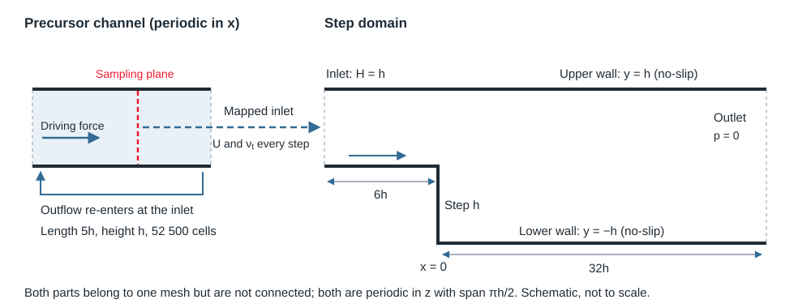

::: {.callout-note}
## What this page is for

This guide supports Questions 3 and 4 of the Assignment 4 PDF. For Question 3 it provides starter code that filters the DNS snapshot, so you can concentrate on the analysis. For Question 4 it explains how the supplied large-eddy simulation (LES) of the backward-facing step was set up and run, and how to read its data. You do not need to run an LES for the assignment. The PDF defines the assessed deliverables; this page gives background and starter code, not answers.
:::

## Where the data are

Everything for Question 4 is on the cluster:

```text
/project/60004/03_Assignment4/LES_Q4         # results: planes, profiles, wall shear, probes, DNS profiles
/project/60004/03_Assignment4/BFS_LES_case   # the OpenFOAM case that produced them
```

The isotropic DNS snapshot for Question 3 is in `/project/60004/03_Assignment4/isotropic`.

Each folder has a `README.md`. Read the README before you start. You can read the results directly from the shared folder in your notebook. **Never edit or run anything inside `/project`.** If you want to look at the case in detail or run it, copy it into your own working folder first:

```bash
mkdir -p Assignment4 && cd Assignment4
cp -R /project/60004/03_Assignment4/BFS_LES_case .
```

## Question 3: filtering the DNS snapshot

The starter below loads the central $128^3$ samples, applies the normalized box filter for one width at a time and forms the exact SGS stress $\tau_{ij}=\overline{u_iu_j}-\bar u_i\bar u_j$ and the resolved strain rate $\bar S_{ij}$. Everything after that (SGS energy, eigenvalues, energy transfer, the Smagorinsky comparison and the plots) is your analysis.

```{.python}
import numpy as np
from scipy.ndimage import uniform_filter

raw = np.load("/project/60004/03_Assignment4/isotropic/isotropic_256_t0001.npy", mmap_mode="r")
u = np.array(raw[64:192, 64:192, 64:192], dtype=np.float64)   # central 128^3 samples, shape (128, 128, 128, 3)
h = 2 * np.pi / 1024                                          # sampling spacing
core = (slice(10, -10),) * 3                                  # common interior used for every comparison

def box_filter(a, n):
    """Normalized n x n x n box filter on the original mesh. mode="nearest" pads instead of
    wrapping; the padded faces lie outside the common interior."""
    return uniform_filter(a, size=n, mode="nearest")

def filtered_fields(u, n):
    """Return the filtered velocity ub (..., 3), the SGS stress tau (..., 3, 3) and the resolved
    strain rate S (..., 3, 3) for a box filter of n samples per direction (Delta = n h)."""
    ub = np.stack([box_filter(u[..., i], n) for i in range(3)], axis=-1)
    tau = np.empty(u.shape[:3] + (3, 3))
    grad = np.empty_like(tau)
    for i in range(3):
        for j in range(3):
            tau[..., i, j] = box_filter(u[..., i] * u[..., j], n) - ub[..., i] * ub[..., j]
            grad[..., i, j] = np.gradient(ub[..., i], h, axis=j, edge_order=2)  # d(ub_i)/dx_j, centered inside
    S = 0.5 * (grad + np.swapaxes(grad, -1, -2))
    return ub, tau, S

for n in (5, 9, 17):
    ub, tau, S = filtered_fields(u, n)
    # Your analysis on the interior, e.g. with tau[core] and S[core].
    del ub, tau, S          # about 0.5 GB per width; free it before the next one
```

Work width by width as above rather than storing all three, and keep only the quantities you need (means, histograms, a plane for plotting).

## Question 4: the LES of the backward-facing step

### What was simulated

The geometry and flow conditions are those of the step you studied in Assignment 3:

| Quantity | Value |
|---|---|
| Step height and inlet-channel height | $h = 0.1\,\mathrm{m}$ (expansion ratio 2) |
| Bulk velocity in the inlet channel | $U_b = 2.0424\,\mathrm{m\,s^{-1}}$ |
| Kinematic viscosity | $\nu = 1.48\times10^{-5}\,\mathrm{m^2\,s^{-1}}$ |
| Reynolds number | $Re = U_b h/\nu = 13\,800$ (nominal inflow $Re_\tau = 395$ based on the channel half-height) |
| Reference data | DNS of @pontvilchez2019, mean reattachment $x_r/h = 8.8$ |

The LES is three-dimensional and time-dependent. It resolves the large turbulent motions and models only the effect of the scales smaller than the grid. @fig-les-setup shows how the domain is built.

{#fig-les-setup width=100%}

### How the turbulent inflow is generated

An LES needs an inflow that is itself turbulent: realistic, time-dependent eddies with the right statistics. A steady profile, or a profile with random noise added, would take a long distance to develop into real turbulence, and that development would change the separation at the step. Common remedies are synthetic-turbulence generators, recycling methods and precursor simulations. This case uses an **embedded precursor**.

1. **A periodic channel runs alongside the step.** The block on the left of @fig-les-setup is a channel of height $h$ and length $5h$. Its inlet and outlet patches are `cyclic`, so flow leaving it re-enters at its inlet and the turbulence recirculates indefinitely. Without a driving force, wall friction would slowly stop the flow. A `meanVelocityForce` source adds exactly the streamwise pressure gradient needed to keep the bulk velocity at $U_b$:

    ```{.cpp filename="system/fvOptions (excerpt)"}
    momentumSource
    {
        type            meanVelocityForce;
        selectionMode   cellSet;
        cellSet         precursor;      // only the precursor cells, created by topoSet
        fields          (U);
        Ubar            ($u_0 0 0);     // target bulk velocity Ub
    }
    ```

2. **The step inlet copies the precursor.** The step inlet is a `mappedPatch`. At every time step it takes the velocity (and eddy viscosity) from the nearest cells on a plane shifted by a fixed offset into the middle of the precursor:

    ```{.cpp filename="system/blockMeshDict (inlet patch)"}
    inlet_bfs
    {
        type            mappedPatch;
        sampleMode      nearestCell;    // values from the nearest cell ...
        offsetMode      uniform;
        offset          (#eval"$x_off+$l_pre/2+$l_inlet" 0 0);   // ... on a plane inside the precursor
        faces           ((4 7 3 0));
    }
    ```

    The velocity field uses the matching boundary condition `type mapped;` on this patch. The step therefore sees the precursor's instantaneous turbulence, eddy by eddy.

3. **The forcing needs a cell set.** `system/topoSetDict` creates the cell set `precursor` from a box around the precursor block. In a parallel run, `topoSet -parallel` must run before the solver so that every processor knows its precursor cells.

::: {.callout-note}
## Why a modified solver?

The precursor is fully periodic and has no outlet, so nothing fixes its pressure level: any constant can be added to $p$ there without changing the flow. The step domain has a fixed-pressure outlet, so OpenFOAM does not apply a pressure reference, and the precursor level can drift. The run therefore used `pimpleFoamPreRef`, a copy of the standard `pimpleFoam` in which the pressure reference (`pRefPoint` in `system/fvSolution`) is always enforced. `prepare_solver.py` creates it from the installed source; nothing else in the solver changes.
:::

**Initial condition.** The precursor started from a separate, wider periodic-channel LES, mapped onto the narrower span and rescaled to $U_b$ (see `mapping_report.json`). The step region started from an earlier LES of the same geometry. Neither is a physical continuation, which is why the run first had an adjustment phase without statistics (see the [run history](#run-history-and-cost)).

### The mesh

The mesh is made by `blockMesh` from `system/blockMeshDict`: block P for the precursor and blocks A to E for the step domain, with all parameters in `globalVariables`.

- 819 000 hexahedral cells in total, including 52 500 in the precursor.
- Base cell size 5 mm (20 cells across $h$ in the core flow), graded towards the walls (`wall_grading 8`).
- 25 cells across the span $\pi h/2$; the span is periodic (`cyclic` front and back patches).

To judge the resolution, express the spacing in wall units, $\Delta^+ = \Delta\,u_\tau/\nu$. For the inflow channel, $Re_\tau = u_\tau\,(h/2)/\nu = 395$ gives $u_\tau \approx 0.117\,\mathrm{m\,s^{-1}}$ and a viscous length $\nu/u_\tau \approx 0.13\,\mathrm{mm}$. For example, the 5 mm core cells are about $39$ wall units. Downstream of the step $u_\tau$ varies strongly, and it is small inside the recirculation region, so local values differ; the `yPlus` history in `LES_Q4/histories` reports the logged first-cell values. Commonly quoted targets for wall-resolved LES of wall-bounded flows are roughly $\Delta x^+ \approx 50$--$150$, $\Delta z^+ \approx 15$--$40$ and a first cell at $y^+ \lesssim 1$.

### Subgrid model and numerics

| Setting | Value | File |
|---|---|---|
| SGS model | Smagorinsky, filter width $\Delta = V^{1/3}$ (`cubeRootVol`) | `constant/turbulenceProperties` |
| Wall treatment | no-slip velocity; `zeroGradient` $\nu_t$ at the walls; no wall damping | boundary conditions in `50.1/U`, `50.1/nut` |
| Time integration | `backward` (second order), adaptive $\Delta t$ with $\mathrm{Co}_{\max}=0.5$, about $2.2\times10^{-4}\,\mathrm{s}$ | `system/fvSchemes`, `system/controlDict` |
| Pressure-velocity coupling | PIMPLE with 1 outer and 2 pressure correctors (PISO-like) | `system/fvSolution` |
| Convection | central differencing (`Gauss linear`) | `system/fvSchemes` |
| Safety limiter | `limitVelocity` at $10\,U_b$ | `system/fvOptions` |

**OpenFOAM's Smagorinsky constants.** OpenFOAM writes the model with two constants. It estimates the subgrid energy from a local balance of production and dissipation, $k_{\mathrm{sgs}} = (2C_k/C_e)\,\Delta^2\,\overline{S}_{ij}\overline{S}_{ij}$, and sets $\nu_t = C_k\,\Delta\sqrt{k_{\mathrm{sgs}}}$. Comparing with the classical form $\nu_t=(C_s\Delta)^2\sqrt{2\overline{S}_{ij}\overline{S}_{ij}}$ gives

$$
C_s = C_k^{3/4}\,C_e^{-1/4} = 0.094^{3/4}\times1.048^{-1/4} \approx 0.17,
$$

the same coefficient you tested *a priori* on filtered DNS in Question 3.

**Why central differencing?** In an LES the scheme acts on resolved eddies. Upwind-type schemes add numerical dissipation that damps the smallest resolved eddies and competes with the SGS model, as discussed in the LES lectures. Central schemes keep that dissipation low, so the SGS model, not the scheme, removes most of the energy at the grid scale.

### What was recorded

The function objects in `system/FOs/` produced the data in `LES_Q4`:

- **`fieldAverage`**: running time averages `UMean`, `pMean`, `nutMean`, `wallShearStressMean`, `yPlusMean`, and the resolved covariance `UPrime2Mean` $=\langle(\overline{u}_i-\langle\overline{u}_i\rangle)(\overline{u}_j-\langle\overline{u}_j\rangle)\rangle_t$, stored in the order `xx xy xz yy yz zz`. The supplied statistics cover $t = 25$ to $50.1\,\mathrm{s}$. With adaptive time steps, each sample is weighted by its time step.
- **Profiles** (`profile_*h.csv`) are these time averages, additionally averaged over the periodic span.
- **Separate windows** (`blocks_*h.csv` and the extra wall-shear columns) are obtained from the cumulative averages. If $M_1$ and $M_2$ are the means from the common start to $t_1$ and $t_2$, accumulated over durations $T_1$ and $T_2$, the mean over $[t_1,t_2]$ is $(T_2M_2-T_1M_1)/(T_2-T_1)$. Subtracting the means directly would be wrong.
- **`tauW`** writes the wall shear stress. OpenFOAM's sign is negative for ordinary forward flow at the lower wall; the README gives the conversion to a conventional skin-friction coefficient.
- **`probes`** record the velocity at four points every 10th time step (coordinates in the file header). **`fluxChecks`** (every 20th step), **`uBulk`** and **`yPlus`** (at every field write, once per second in the production run) and **`courantNumber`** monitor the run.
- **`cutplanes`** wrote the $z=0$ plane every $0.01\,\mathrm{s}$. The data contain five widely separated planes (25 to 45 s) and a dense sequence of 101 planes from $49$ to $50\,\mathrm{s}$.

### Run history and cost

| Stage | Simulated time | Cores | Wall time | Purpose |
|---|---|---|---|---|
| 1. Initialization test | 0 to 0.1 s | 80 | under a minute | check that the setup starts cleanly |
| 2. Adjustment | 0.1 to 25 s | 192 | about 3.2 h | let the flow forget its initial condition; no statistics |
| 3. Production | 24.1 to 50.15 s | 192 | about 3.4 h | continue and accumulate statistics from $t = 25\,\mathrm{s}$ |

Stages 2 and 3 together used about 1 300 core-hours, roughly 115 000 time steps per stage. The step section ($6h$ upstream plus $32h$ downstream, $3.8\,\mathrm{m}$) takes about $1.9\,\mathrm{s}$ to traverse at $U_b$, so the averaging window spans about 13 flow-throughs. The `logs/` folder in the case contains the start and end of each stage's solver output.

### Starter: reading the Question 4 data

These snippets only load the data; plotting and analysis are part of the assignment.

```{.python}
from pathlib import Path
import numpy as np
import pandas as pd

DATA = Path("/project/60004/03_Assignment4/LES_Q4")
h, Ub = 0.1, 2.0424

# Spanwise-averaged time-mean profile at the station nearest x/h = 3 (dimensional SI units)
prof = pd.read_csv(DATA / "profile_3h.csv")
print(prof.columns.tolist())     # x, y, UMean_x, ..., Rxx, Rxy, Rxz, Ryy, Ryz, Rzz
y_h, U_Ub = prof["y"] / h, prof["UMean_x"] / Ub

# DNS reference: already normalized; the first column is an export index
dns = pd.read_csv(DATA / "DNS_profiles" / "xLine_3h.csv")

# Mean wall shear on the lower wall downstream of the step
ws = pd.read_csv(DATA / "wall_shear.csv")
```

The plane sequence is cell data on polygons:

```{.python}
seq = np.load(DATA / "sequence.npz")
times, Uplane = seq["times"], seq["U"]          # Uplane: (n_times, n_cells, 3)
ends = seq["offsets"]
starts = np.r_[0, ends[:-1]]
polys = [seq["points"][seq["connectivity"][a:b], :2] / h for a, b in zip(starts, ends)]
# Draw with matplotlib.collections.PolyCollection(polys, array=...), keeping the colour limits fixed.
```

### Optional: continue the LES yourself

The case folder contains the mesh and the developed flow at $t = 50.1\,\mathrm{s}$, so you can watch the real LES run. This is optional and not assessed. Work in your copy of the case (see [Where the data are](#where-the-data-are)):

```bash
cd BFS_LES_case
module load StdEnv/2023 gcc/12.3 openmpi/4.1.5 openfoam/v2412
python3 prepare_solver.py        # once: copies pimpleFoam and patches the pressure reference
wmake solver                     # once: builds $FOAM_USER_APPBIN/pimpleFoamPreRef
# edit job.sh: set --account to the course allocation
sbatch job.sh
```

`job.sh` follows the workflow on the [running in parallel](../openfoam/parallel.qmd) page: it decomposes the case into 16 parts, recreates the precursor cell set with `topoSet -parallel`, runs `pimpleFoamPreRef -parallel` and reconstructs the last time. See the [Slurm](../cluster/slurm.qmd) page for monitoring the job.

- The default end time ($50.2\,\mathrm{s}$) is a $0.1\,\mathrm{s}$ test of about 450 time steps, roughly 10 to 20 minutes on 16 cores. Each full-field write is about 70 MB.
- `fieldAverage` starts fresh at $50.1\,\mathrm{s}$, so a short run gives unconverged statistics. Compare its length with the 25 s window behind the supplied data.
- The initial fields at $t = 0$ are not included, so the full history cannot be repeated.

## Further reading

- The LES lectures (filtering, SGS models, numerics, walls and hybrid methods) and @pope2000, Chapter 13.
- [OpenFOAM: running in parallel](../openfoam/parallel.qmd), [Slurm](../cluster/slurm.qmd) and the [tips and tricks](../openfoam/tips-and-tricks.qmd) page on discretization schemes.
- The [Assignment 3 OpenFOAM guide](assignment-03-openfoam.qmd) for the RANS cases of the same step.

## References

::: {#refs}
:::
