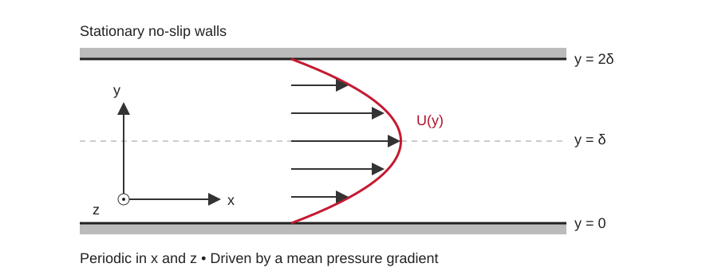
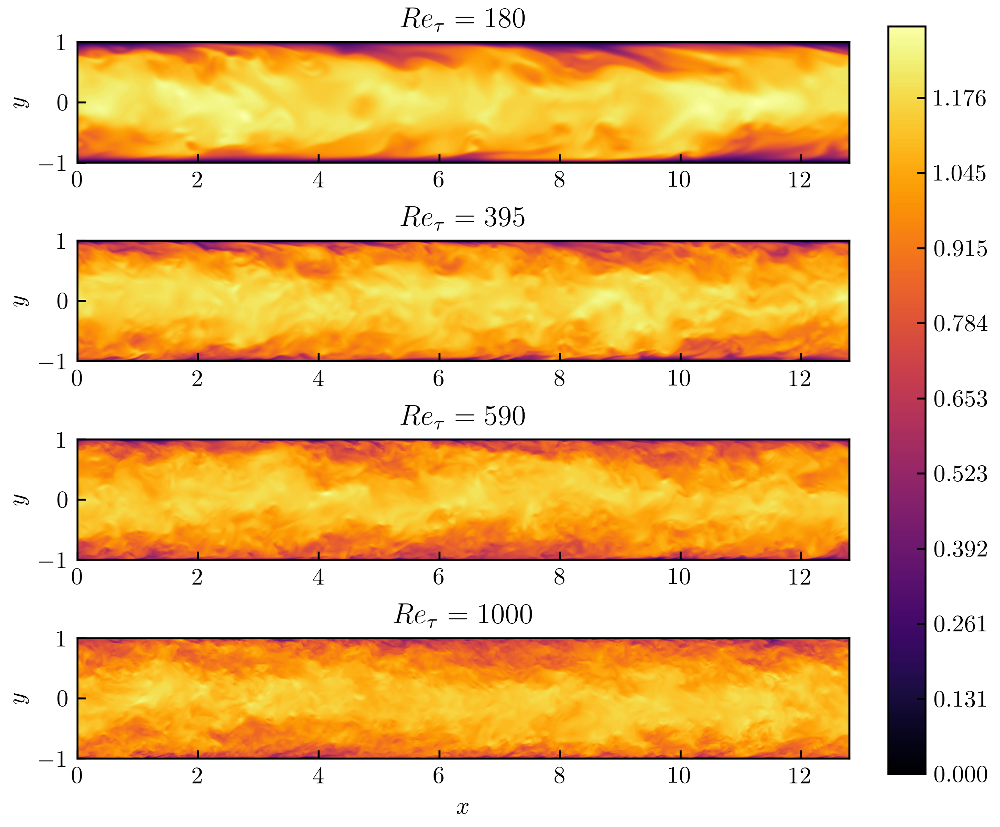

::: {.callout-note}
## What this tutorial is about

In Tutorial 1, we studied turbulence without walls or mean shear. Here we introduce a canonical wall-bounded flow: a turbulent channel. We will explain how the flow is driven, where the turbulence gets its energy, and how instantaneous velocity fields become the profiles used in Assignment 3. Allow about 15 minutes. This page provides background; the assignment contains the assessed questions.
:::

## Why a channel?

Consider two stationary parallel walls separated by $2\delta$. Let $x=x_1$ be streamwise, $y=x_2$ the distance from the lower wall, and $z=x_3$ spanwise. The lower wall is at $y=0$ and the centerline at $y=\delta$.

{#fig-channel-geometry width=90%}

The geometry is simple, but the turbulence is not. Instantaneous velocity varies in all three directions and in time. Once the flow is statistically stationary and fully developed, its mean statistics depend only on $y$. This gives us a manageable setting for studying wall effects, shear production, unequal component energies and Reynolds-number dependence.

It also gives us exact mean-flow balances against which to check data and models. Channel DNS is consequently a useful benchmark, although success here does not establish accuracy for separated flows or complex geometries.

{#fig-channel-structures width=95%}

## How is turbulence generated and sustained?

A pressure drop drives the mean flow. No-slip walls impose zero velocity at the surfaces, producing a mean velocity gradient. Disturbances can develop into turbulence at a suitable Reynolds number; in computations we commonly start from a turbulent restart or a mean profile with finite disturbances. A perfectly undisturbed laminar initialization should not be expected to become turbulent automatically.

Near a wall, wall-normal motion carries fluid between regions of different mean streamwise velocity. An ejection carries relatively slow fluid away from the lower wall ($u'<0$, $v'>0$); a sweep brings relatively fast fluid toward it ($u'>0$, $v'<0$). Both contribute negatively to $\langle u'v'\rangle$. Streamwise streaks and vortical motions participate in the continuing regeneration of these fluctuations.

For the lower half-channel, the transfer of mean kinetic energy into turbulent kinetic energy is

$$
P_k=-\langle u'v'\rangle\frac{\mathrm dU}{\mathrm dy}.
$$

Typically $\mathrm dU/\mathrm dy>0$ and $\langle u'v'\rangle<0$, giving positive production. Nonlinear interactions transfer energy between scales, and viscosity ultimately dissipates it. The original channel DNS studies document these statistics and structures [@kim1987channel; @moser1999channel].

::: {.callout-important appearance="simple"}
## What supplies the energy?

Pressure forcing supplies mechanical energy to the flow. Mean shear transfers some of it into turbulent fluctuations. The stationary walls impose no-slip and shape the shear, but they do no mechanical work because their velocity is zero. Periodic boundaries do not supply energy either.
:::

## How would we run the simulation?

A standard fully developed channel calculation uses a finite domain of dimensions $L_x\times2\delta\times L_z$:

1. Impose no-slip and no-penetration at both walls.
2. Impose periodic velocity boundary conditions in $x$ and $z$. Fluid leaving one periodic face re-enters through the opposite face.
3. Drive the streamwise flow with a mean pressure gradient or its equivalent uniform acceleration.
4. Initialize turbulence, run through the transient, and monitor bulk velocity, wall stress and kinetic energy.
5. Once the statistics no longer drift systematically, accumulate averages over many flow time scales. Check their convergence using separate averaging intervals.

With a prescribed pressure gradient, define

$$
g=-\frac{1}{\rho}\frac{\mathrm d\overline p}{\mathrm dx}>0.
$$

The streamwise momentum equation contains the acceleration $g$. Equivalently, split pressure into a linear driving part and a periodic remainder: $p=-\rho gx+\widetilde p$. Use one representation of the forcing, not both. At statistical equilibrium,

$$
\tau_w=\rho g\delta.
$$

Alternatively, prescribe the bulk velocity

$$
U_b=\frac{1}{2\delta}\int_0^{2\delta}U(y)\,\mathrm dy
$$

and adjust the forcing to maintain it. For fixed pressure gradient the flow rate responds; for fixed flow rate the pressure gradient responds. Specify which is controlled when comparing calculations.

DNS solves the unsteady Navier–Stokes equations without a turbulence closure. It needs sufficient spatial and temporal resolution, especially near the walls, and a domain large enough for the relevant motions. Turning off a turbulence model on a coarse grid does not make a calculation a resolved DNS. The original studies describe their numerical methods and resolution choices [@kim1987channel; @moser1999channel; @lee2015channel]. For this assignment, we analyze their supplied statistics rather than rerun the simulations.

## Running it in non-dimensional form

Normalize all lengths by the channel half-height $\delta$. The domain is then **2 units tall**
(walls at $y=0$ and $y=2$, centerline at $y=1$), and we fix $\rho=1$ and the kinematic viscosity
$\nu=1$ once and for all. With $\delta=1$ and $\nu=1$ the friction Reynolds number collapses to

$$
Re_\tau=\frac{u_\tau\delta}{\nu}=u_\tau ,
$$

so the only thing that distinguishes one Reynolds number from another is the **forcing**.

**$Re_\tau$ goes into the forcing.** A fully developed channel is sustained by a constant
streamwise body force $g$ (a mean pressure gradient). At equilibrium the force over the
half-height balances the wall stress,

$$
\tau_w=\rho\,g\,\delta
\qquad\Longrightarrow\qquad
u_\tau=\sqrt{g\,\delta}=\sqrt{g}.
$$

Since we want $u_\tau=Re_\tau$, set the body force to

$$
g=Re_\tau^{2}.
$$

That is the whole recipe: keep the geometry (height 2) and $\nu=1$ fixed, and change only the
forcing, $g=Re_\tau^2$, to select the Reynolds number. The non-dimensional momentum equation is

$$
\frac{\partial u_i}{\partial t}+u_j\frac{\partial u_i}{\partial x_j}
=-\frac{\partial \widetilde p}{\partial x_i}
+\frac{\partial^2 u_i}{\partial x_j\,\partial x_j}
+Re_\tau^{2}\,\delta_{i1},
$$

with the single parameter $Re_\tau$ now living in the forcing term.

Recovering wall units afterwards is immediate: $u_\tau=Re_\tau$, so $U^+=U/Re_\tau$ and
$y^+=Re_\tau\,(y/\delta)$.

::: {.callout-tip}
## Recipe: one geometry, one $\nu$, change the forcing
- Channel height $2$ ($\delta=1$); a typical domain is $2\pi\times 2\times \pi$ in $(x,y,z)$.
- $\nu=1$ and $\rho=1$, the same for every case.
- Constant streamwise body force $g=Re_\tau^{2}$ (e.g.\ $395^2\approx1.56\times10^{5}$ for $Re_\tau=395$).
- Outputs are in viscous units: divide velocities by $Re_\tau$ to get $U^+$, and $y^+=Re_\tau\,(y/\delta)$.
- The near-wall spacing in wall units is $\Delta y^+=Re_\tau\,\Delta y$, so refine the mesh as $Re_\tau$ grows.
:::

In OpenFOAM the viscosity goes in `constant/transportProperties` and the constant force is a
momentum source in `system/fvOptions`:

```{.cpp filename="constant/transportProperties"}
transportModel  Newtonian;
nu              1;        // fixed for every Re_tau
```

```{.cpp filename="system/fvOptions"}
momentumSource
{
    type            vectorSemiImplicitSource;   // constant body force = fixed pressure gradient
    selectionMode   all;
    volumeMode      specific;
    injectionRateSuSp
    {
        U   ((156025 0 0) 0);   // g = Re_tau^2,  here Re_tau = 395  ->  395^2 = 156025
    }
}
```

(The exact `fvOptions` keyword can vary slightly between OpenFOAM versions; the physics is just a
constant source $Su=(Re_\tau^2,0,0)$ added to every cell.)

::: {.callout-note appearance="simple"}
## Fixed force vs.\ fixed flow rate
Driving with this **constant force** fixes the wall stress, so you set $Re_\tau$ directly
(through $g=Re_\tau^2$) and the bulk velocity $U_b$ comes out as a result. OpenFOAM's
`meanVelocityForce` does the opposite: it holds a prescribed **bulk** velocity and lets the
pressure gradient, and therefore $u_\tau$ and $Re_\tau$, be the output. Both are valid; just state
which one you controlled, and check at equilibrium that the measured $u_\tau$ (from the wall shear)
matches your target.
:::

## From instantaneous fields to statistics

At each wall distance, average over the homogeneous $x,z$ plane and over time after the transient. Conceptually,

$$
\langle f\rangle(y)=\frac{1}{T L_xL_z}
\int_{t_0}^{t_0+T}\int_0^{L_z}\int_0^{L_x}
 f(x,y,z,t)\,\mathrm dx\,\mathrm dz\,\mathrm dt.
$$

The finite average estimates the statistical mean; correlated samples are not independent realizations. Do not average over $y$: that would erase the wall-normal variation we want to study.

Define $U_i=\langle u_i\rangle$ and $u_i'=u_i-U_i$. Ideally the mean velocity has only one nonzero component, $U_1=U(y)$.

| Quantity | Definition | Interpretation |
|---|---|---|
| Mean velocity | $U(y)=\langle u_1\rangle$ | Average streamwise motion |
| Normal covariance | $R_{ii}=\langle (u_i')^2\rangle$, no sum | Variance of one velocity component |
| RMS fluctuation | $\sqrt{R_{ii}}$, no sum | Typical fluctuation amplitude, with velocity units |
| Shear covariance | $R_{12}=\langle u'v'\rangle$ | Correlated streamwise and wall-normal motion |
| Turbulent kinetic energy | $k=(R_{11}+R_{22}+R_{33})/2$ | Fluctuation energy per unit mass |
| Production | $P_k=-R_{12}\,\mathrm dU/\mathrm dy$ | Transfer from mean-flow energy into turbulence |

The turbulent contribution to mean shear stress is $-\rho R_{12}$; the tabulated covariance itself has units of velocity squared before normalization. The three normal variances need not be equal.

“Statistically stationary” means that the statistical distribution does not change with time. “Fully developed” means that the mean statistics do not change downstream. Neither means that the instantaneous velocity is steady.

## Wall units and useful checks

Define friction velocity, wall distance and friction Reynolds number by

$$
u_\tau=\sqrt{\tau_w/\rho},\qquad
y^+=\frac{yu_\tau}{\nu},\qquad
U^+=\frac{U}{u_\tau},\qquad
Re_\tau=\frac{u_\tau\delta}{\nu}.
$$

Also $R_{ij}^+=R_{ij}/u_\tau^2$ and $P_k^+=\nu P_k/u_\tau^4$. These use wall stress and viscosity to compare different flows. Nondimensionalization is always possible; exact collapse of profiles is an additional physical claim.

Very near a smooth wall, $U^+\simeq y^+$. This is an asymptotic result. An extended logarithmic region requires sufficient separation between the viscous and outer scales; it should not be assumed throughout the channel.

The same mean momentum equation yields an *exact* relation for stationary, fully
developed flow: the viscous and turbulent shear add up to a total shear that falls off
**linearly** with wall distance, reaching zero at the centerline by symmetry. At the
wall, fluctuations vanish and viscosity carries all of the shear; away from it, turbulent
transport takes over.

::: {.callout-note appearance="simple"}
## Left to the assignment
Deriving this total-stress balance, plotting the viscous shear, turbulent shear and their
sum, and checking their residual against the exact linear profile are part of
**Question 1 of Assignment 3**, so the derivation and those plots are not reproduced here.
Finite sampled DNS statistics can leave a small residual even though the relation is exact.
:::

## The data used in Assignment 3

Our files come from Moser, Kim and Mansour (1999), with nominal $Re_\tau=180,395,590$ [@moser1999channel]. Use the actual header values, $178.12$, $392.24$ and $587.19$, in calculations. The [official database](https://turbulence.oden.utexas.edu/MKM_1999.html) provides profiles and additional statistics.

The data are available on the cluster at:

```text
/project/60004/02_Assignment3/00_Data/chandata
```

This directory contains `chan180`, `chan395` and `chan590`.

| File relative to this directory | What to read |
|---|---|
| `chanXXX/profiles/chanXXX.means` | $y/\delta$, $y^+$, $U^+$ and the supplied mean gradient |
| `chanXXX/profiles/chanXXX.reystress` | Normal and off-diagonal covariances in wall units |
| `chanXXX/balances/chanXXX.kbal` | Terms in the turbulent kinetic-energy budget; the fourth column is production |

::: {.callout-tip}
## Three conventions to check before plotting

- The files are already normalized. Do not divide their velocities or stresses by $u_\tau$ again.
- The fourth `.means` column is $\mathrm dU^+/\mathrm d(y/\delta)$, **not** $\mathrm dU^+/\mathrm dy^+$. Working out how the two are related, and applying it, is part of Assignment 3 (Q1).
- `.reystress` contains variances and covariances, not RMS velocities. Read the header of every file, including the signs used for budget terms.
:::

### Starter: reading the ASCII files

The files are plain ASCII: a comment header (lines starting with `%`) followed by numeric
columns. A minimal reader, which you can drop into your notebook and build on:

```{.python}
from pathlib import Path
import numpy as np

# On the cluster the data live at the path shown above. For a reproducible submission,
# copy or symlink them next to your notebook and use a RELATIVE path here.
DATA = Path("chandata")      # e.g. ./chandata/chan395/profiles/chan395.means

def peek_header(path, n=12):
    """Print the comment header so you can confirm Re_tau and the column order."""
    for line in Path(path).read_text().splitlines()[:n]:
        if line.lstrip().startswith(("%", "#")):
            print(line)

def load_case(case):
    """Read one case, e.g. load_case('chan395').
    Columns follow the table above; always check the header first with peek_header().
    If loadtxt trips on the header, adjust `comments` or pass skiprows=N."""
    d = DATA / case
    means = np.loadtxt(d / "profiles" / f"{case}.means",     comments=("%", "#"))
    rey   = np.loadtxt(d / "profiles" / f"{case}.reystress", comments=("%", "#"))
    kbal  = np.loadtxt(d / "balances" / f"{case}.kbal",      comments=("%", "#"))
    return {
        "y_delta": means[:, 0], "yplus": means[:, 1], "Uplus": means[:, 2],
        "dUp_dyouter": means[:, 3],       # dU+/d(y/delta), NOT dU+/dy+ (see Assignment 3, Q1)
        "R11": rey[:, 2], "R22": rey[:, 3], "R33": rey[:, 4],
        "R12": rey[:, 5], "R13": rey[:, 6], "R23": rey[:, 7],
        "production": kbal[:, 3],         # production term (see header for normalization/sign)
    }

cases = {name: load_case(name) for name in ("chan180", "chan395", "chan590")}

# sanity check
peek_header(DATA / "chan395" / "profiles" / "chan395.means")
print(cases["chan395"]["Uplus"].shape)
```

Read $Re_\tau$ from each file's header (not the folder name), and keep in mind that the fourth
`.means` column is $\mathrm dU^+/\mathrm d(y/\delta)$, not $\mathrm dU^+/\mathrm dy^+$.

The historical sequence is worth distinguishing: Kim, Moin and Moser (1987) established the classic low-Reynolds-number channel study; Moser, Kim and Mansour (1999) supplied the three cases used here; Lee and Moser (2015) extended the investigation to $Re_\tau\approx5200$, allowing a much wider separation of scales [@kim1987channel; @moser1999channel; @lee2015channel].

Before starting the assignment, make sure you can answer these.

::: {.callout-important}
## Self-check 1 --- What supplies the energy?
The walls are stationary and the streamwise and spanwise boundaries are periodic. Where does
the energy that sustains the turbulence come from?
:::

::: {.callout-note collapse="true"}
## Answer
The imposed **mean pressure gradient** (the forcing) does work on the flow and supplies the
mechanical energy; mean shear then transfers part of it into the fluctuations
($P_k=-\langle u'v'\rangle\,\mathrm dU/\mathrm dy$). The walls do no work because their velocity
is zero, and periodic boundaries supply none.
:::

::: {.callout-important}
## Self-check 2 --- Why do smooth, $y$-only profiles emerge?
The instantaneous field varies in all three directions and in time. Why do the mean statistics
depend on $y$ alone?
:::

::: {.callout-note collapse="true"}
## Answer
The flow is statistically **stationary** and **homogeneous in $x$ and $z$**. Averaging over those
two homogeneous directions and over time cancels the three-dimensional, unsteady fluctuations and
leaves means that vary only with wall distance $y$. The instantaneous field stays fully 3-D and
unsteady; it is the averaging over the symmetry directions that produces the smooth profiles.
:::

::: {.callout-important}
## Self-check 3 --- Zero turbulent shear at a wall with nonzero wall stress?
The wall shear stress $\tau_w$ is finite, yet the turbulent (Reynolds) shear stress vanishes at
the wall. How do these coexist?
:::

::: {.callout-note collapse="true"}
## Answer
No-slip forces every fluctuation to vanish at the wall, so $-\rho\langle u'v'\rangle\to0$ there.
The wall stress is carried **entirely by the viscous (mean) stress**, $\tau_w=\rho\,\nu\,\mathrm
dU/\mathrm dy$ at $y=0$, which is finite. Turbulent transport only takes over away from the wall,
where the fluctuations grow.
:::

## References

::: {#refs}
:::
